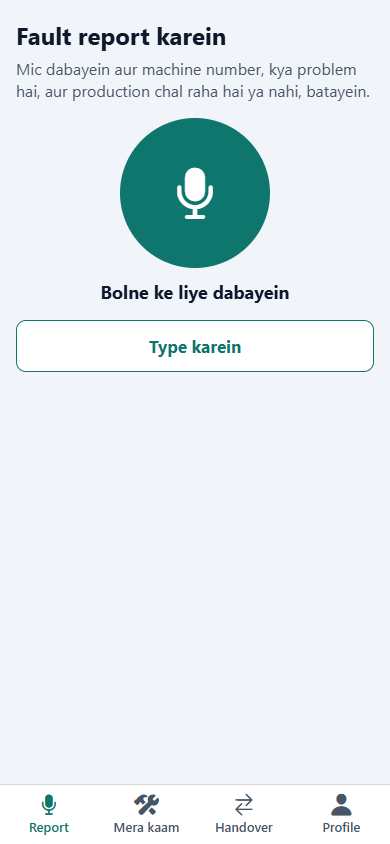
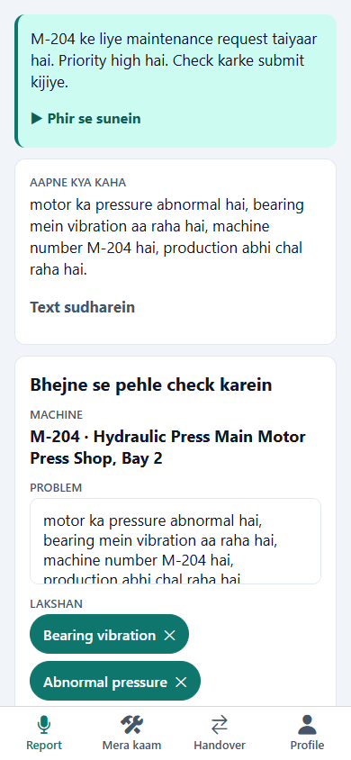
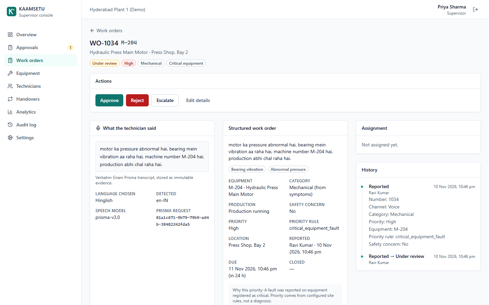
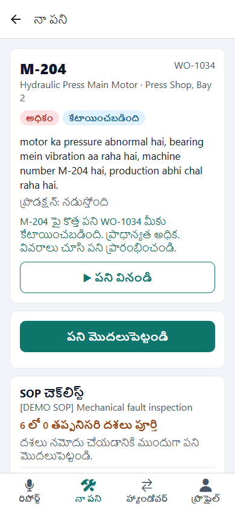
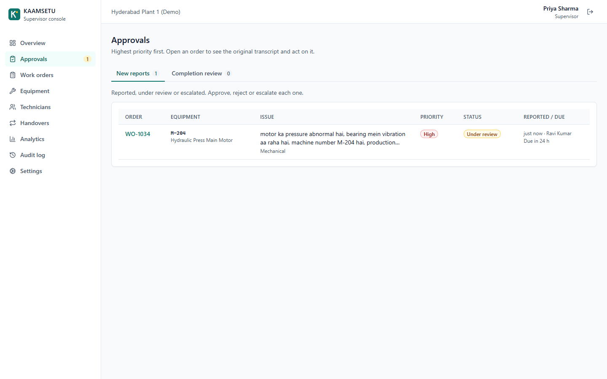
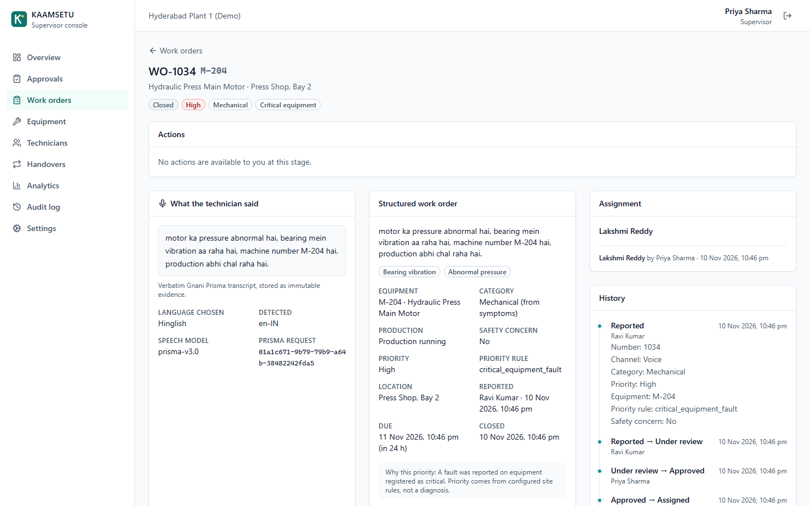
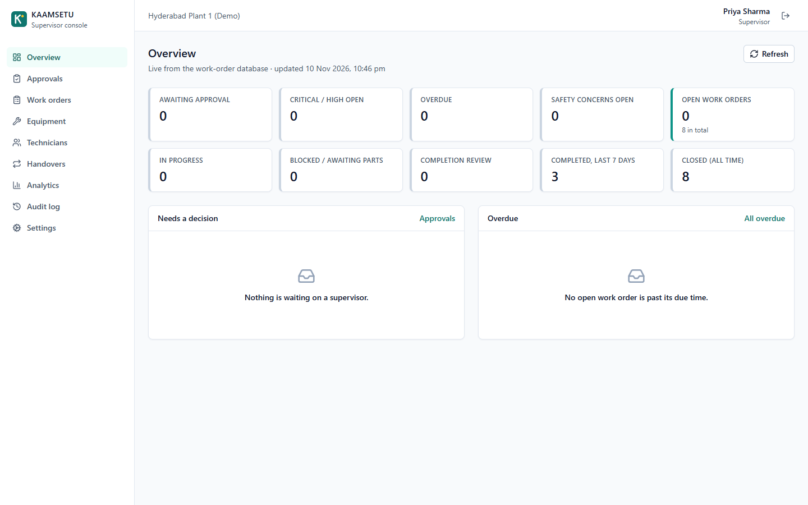
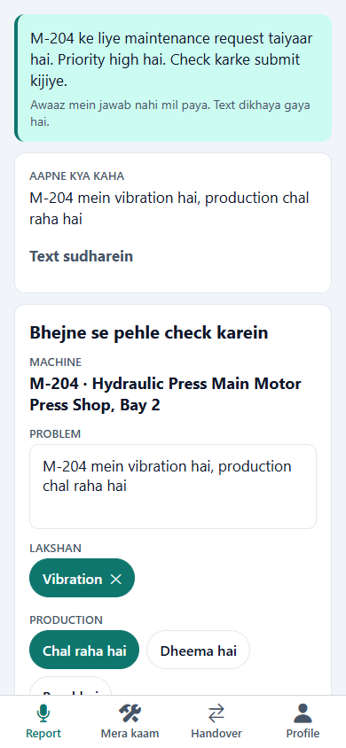

# KAAMSETU

**Speak the work. Structure the action. Keep operations moving.**

KAAMSETU is a voice-first maintenance platform for factory floors.
- A technician reports a machine fault by speaking in **Hindi, Telugu, English or Hinglish**.
- Gnani **Prisma** transcribes it, and a deterministic engine turns it into a validated work order request.
- A supervisor approves and assigns it in the web console.
- The assigned technician hears the task in their own language and works the SOP checklist to completion.
- Gnani **Timbre** speaks every reply, and every step is audited.

Built for the Gnani AI Great Indian AI Internship Challenge. Submission write-up: [docs/SUBMISSION.md](docs/SUBMISSION.md).

> **Status: complete prototype (phases 0–9).** Measured, reviewed and containerised. The only link not yet
> verified is a run on a physical phone; [docs/DEVICE_TEST.md](docs/DEVICE_TEST.md) is the checklist for it.
> All data is synthetic.

| Technician speaks | Spoken preview | Supervisor sees the evidence | Task in Telugu |
|---|---|---|---|
|  |  |  |  |

| Approval queue | Closed, with full history | Overview | Timbre down: text, work continues |
|---|---|---|---|
|  |  |  |  |

## How it works

```
Technician (Expo app)                       Backend (FastAPI + PostgreSQL)                      Supervisor (web)
 speak, up to 30 s (.m4a) ──────────────▶  Prisma v3.0 STT (site machine codes as key terms)
                                           rules: machine code, symptoms, production, safety
                                           register check · priority policy · missing fields
 hear + see the preview ◀─── Timbre v2.5 ─ next step: confirm / ask one question / pick machine
 confirm ───────────────────────────────▶  work order + immutable evidence + audit ─────────▶  approve / assign
 hear the task, SOP checklist, complete ◀─ Timbre task announcement in the assignee's language  close
```

- **Voice is the interface.** Prisma and Timbre are called only from the backend; the key never reaches a client.
- **No LLM.** Extraction is rule-based and configurable (`backend/app/intelligence/config/*.yaml`). It cannot invent
  a machine: unregistered codes never become work orders.
- **The backend is the source of truth.** One state-machine table, role checks, a checklist gate, no
  self-approval, row locks, and an append-only audit trail.
- **It asks instead of guessing.** A missing field becomes one spoken question; a failed speech service degrades to
  text.

## Gnani usage

| | Prisma | Timbre |
|---|---|---|
| Model | `prisma-v3.0` (`POST /stt/v3`) | `timbre-v2.5` (`POST /api/v1/tts/inference`) |
| Languages / voices | `en-IN`, `hi-IN`, `te-IN`; Hinglish as `en-IN` | Kaveri, Nalini, Suhana, Poorvi (Hinglish) |
| Where | reports, follow-up answers, spoken handovers | previews, questions, acknowledgements, task announcements, completion |

Details, measured behaviour and failure mapping: [docs/GNANI_INTEGRATION.md](docs/GNANI_INTEGRATION.md).

## Measured results

From [evaluation/RESULTS.md](evaluation/RESULTS.md). The speech is Timbre-generated, not human, so these are
synthetic results:

- **Held-out v2** (20 new reports): **45%** of reports came out fully right on the first pass. Equipment 95%,
  category 100%, safety 95%. Of the rest, most needed one follow-up answer and 2 of 20 gave a wrong preview.
- **Held-out v1** (40 reports, before any tuning): 68% fully right from speech, 72% from typed text.
- **Prisma:** word error rate about 0 for English, Hinglish and Telugu; 0.3 for Hindi, mostly English loanwords
  written in Latin script.
- **Timing:** the app measured 2.4–3.0 s from "stop" to a spoken preview. Median request latency is about 0.3 s.
- **Tests:**
  - backend: 494 tests, 95.9% line coverage, plus 15 real-API tests;
  - supervisor web: 49 tests, 91.6%;
  - technician app: 39 tests, 91.7%;
  - end to end: **74 of 74** across both apps with real Gnani, including 12 failure cases ([e2e/README.md](e2e/README.md)).

## Run it

### A. Docker: database, API and supervisor console

```powershell
Copy-Item backend\.env.example backend\.env      # paste GNANI_API_KEY; set a random JWT_SECRET_KEY (32+ chars)
docker compose up -d --build
docker compose exec backend python scripts/seed.py
# console http://localhost:8080   API http://localhost:8001/docs   (Postgres on host port 5433)
```

### B. Development setup

Prerequisites: Docker Desktop, Python 3.12+ (`py -3.14` here), Node 20+.

```powershell
docker compose up -d db

cd backend
py -3.14 -m venv .venv
$env:DISABLE_SQLALCHEMY_CEXT="1"                                   # see the Windows note
.\.venv\Scripts\python.exe -m pip install --no-binary sqlalchemy -r requirements.txt
.\.venv\Scripts\python.exe -m alembic upgrade head
.\.venv\Scripts\python.exe scripts\seed.py
.\.venv\Scripts\python.exe -m uvicorn app.main:app --reload --host 0.0.0.0 --port 8001

cd ..\supervisor-web ; npm install ; npm run dev                   # http://localhost:5173 (proxies /api to 8001)
cd ..\technician-app ; npm install ; npx expo start                # Expo Go; EXPO_PUBLIC_API_URL=http://<LAN-IP>:8001
```

Ports 5433 (DB) and 8001 (API) are used because a native PostgreSQL and another project already take 5432 and 8000
on the development machine; override them with `KAAMSETU_DB_HOST_PORT`, `KAAMSETU_API_HOST_PORT` and
`KAAMSETU_WEB_HOST_PORT`. An installable Android preview build (`eas build -p android --profile preview`) is
described in [docs/DEPLOYMENT.md](docs/DEPLOYMENT.md).

### C. Verify

```powershell
cd backend ; .\.venv\Scripts\python.exe -m pytest                  # Gnani mocked; separate kaamsetu_test DB
$env:RUN_GNANI_INTEGRATION="1"; .\.venv\Scripts\python.exe -m pytest -m integration   # real Gnani
cd ..\supervisor-web ; npm test ; npm run build
cd ..\technician-app ; npm test ; npm run typecheck
cd ..\e2e ; npm install ; node run.mjs                             # both apps, real APIs, about 4 min
cd ..\backend ; .\.venv\Scripts\python.exe ..\evaluation\run_eval.py --text-only   # accuracy, no Gnani calls
```

### Windows note (Smart App Control)

Unsigned native binaries in a virtualenv are blocked on the development machine. So SQLAlchemy runs without its C
extensions (`--no-binary sqlalchemy`), the Postgres driver is pure-Python `pg8000`, and tools run as
`python -m <tool>`. None of this applies inside Docker. The `e2e/` harness drives Microsoft Edge and uses Windows
Media Foundation for its fake-microphone audio.

## Demo accounts (synthetic seed)

| Role | Email | Language |
|---|---|---|
| Technician | tech1@kaamsetu.demo | Hinglish |
| Technician | tech2@kaamsetu.demo | Telugu |
| Technician | tech3@kaamsetu.demo | Hindi |
| Supervisor | supervisor@kaamsetu.demo | English |
| Manager | manager@kaamsetu.demo | English |

The password for every demo account is `Kaamsetu@2026`. The seed also creates 12 machines (M-204 is the demo motor),
three `[DEMO SOP]` checklists and seven closed historical orders. Do not run the seed on a shared deployment.

## Stack and layout

| Part | Technology |
|---|---|
| Backend | Python 3.12+, FastAPI, Pydantic 2, SQLAlchemy 2, Alembic, PostgreSQL 16, PyJWT, argon2 |
| Speech | Gnani Prisma v3.0, Gnani Timbre v2.5 (REST via `httpx`) |
| Supervisor web | React 18, TypeScript, Vite 6, Tailwind 3, TanStack Query 5, React Router 7, Recharts 3, Vitest 5 |
| Technician app | React Native 0.88, Expo SDK 58, expo-audio, expo-secure-store, React Navigation 7, Jest + RNTL 14 |
| Infra | Docker Compose (db, backend, nginx console), Playwright-driven `e2e/` harness |

```
backend/          FastAPI app, migrations, tests, seed        supervisor-web/  console (Vite + React) + nginx image
technician-app/   Expo app                                     e2e/             end-to-end harness, fault proxy
evaluation/       labelled sets, runner, measured results      docs/            everything below
```

## Documentation

| | |
|---|---|
| [SUBMISSION.md](docs/SUBMISSION.md) | challenge write-up |
| [ARCHITECTURE.md](docs/ARCHITECTURE.md) | design and 34 recorded decisions |
| [API_DOCUMENTATION.md](docs/API_DOCUMENTATION.md) · [DATABASE_DESIGN.md](docs/DATABASE_DESIGN.md) | contracts and schema |
| [GNANI_INTEGRATION.md](docs/GNANI_INTEGRATION.md) | how Prisma and Timbre are called, and what was measured |
| [evaluation/RESULTS.md](evaluation/RESULTS.md) · [TESTING.md](docs/TESTING.md) | accuracy and test results |
| [SECURITY.md](docs/SECURITY.md) · [LIMITATIONS.md](docs/LIMITATIONS.md) | review and known limits |
| [DEPLOYMENT.md](docs/DEPLOYMENT.md) | Docker, Android build, what changes for a pilot |
| [DEMO_SCRIPT.md](docs/DEMO_SCRIPT.md) · [DEMO_VIDEO.md](docs/DEMO_VIDEO.md) · [DEVICE_TEST.md](docs/DEVICE_TEST.md) | demo, video shot list, phone checklist |
| [ROADMAP.md](docs/ROADMAP.md) | the nine phases and what each delivered |

## Honesty notes

- KAAMSETU is a prototype. It is not a safety system and does not diagnose machines. Priority comes from
  configured rules, and checklists only show company-approved SOP text.
- Speech is real Gnani API traffic. When a service fails, the app says so and falls back to text; it never fakes
  a result.
- The accuracy numbers come from synthetic speech. The headline held-out figure was measured before any tuning on
  that set.
